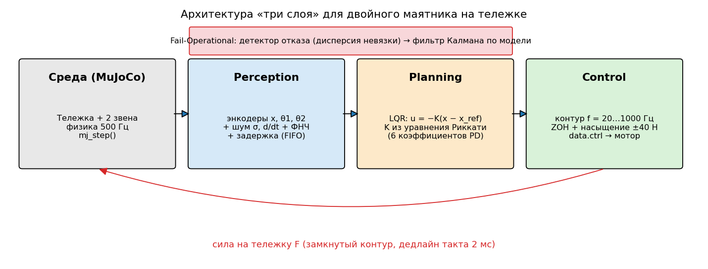
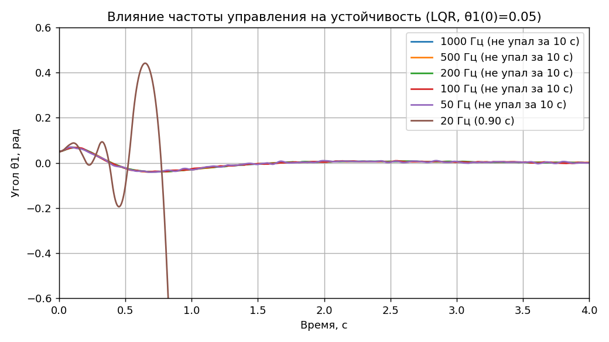
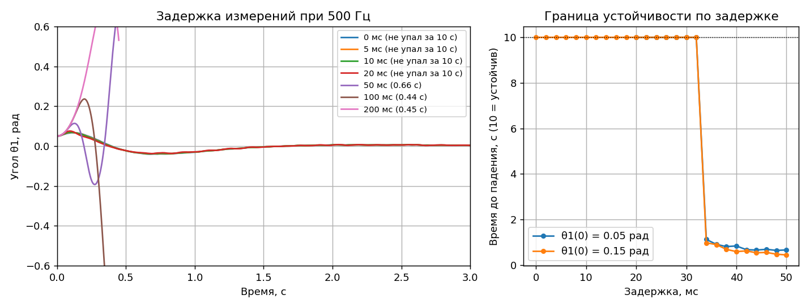
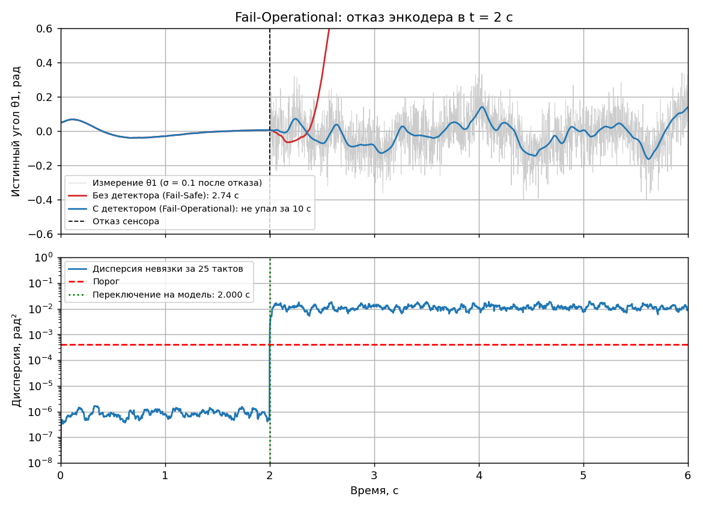

# Лабораторная работа №1 — Physical AI, вариант 5

**Двойной обратный маятник на тележке (нелинейная динамика)** — слои Perception → Planning → Control, эксперименты по частоте и задержке, Fail-Operational.

Отчёт: [report/Отчёт_ЛР1_вариант5.docx](report/Отчёт_ЛР1_вариант5.docx) · ноутбук с результатами: [lab1.ipynb](lab1.ipynb)



## Запуск

```bash
pip install -r requirements.txt
python experiments.py     # все эксперименты -> figures/, results/results.json (~25 с)
python make_report.py     # отчёт .docx из результатов
```

## Структура

| Файл | Что внутри |
|---|---|
| `models/double_cartpole.xml` | MuJoCo-модель: тележка 1 кг, звенья 0.5 м (0.3 и 0.2 кг), мотор ±40 Н, физика 500 Гц |
| `lab1/perception.py` | энкодеры с шумом, скорости дифференцированием + ФНЧ, `DelayedSensor` |
| `lab1/planning.py` | линеаризация `mjd_transitionFD`, LQR (PD по 6 переменным состояния), базовый PD |
| `lab1/control.py` | `ControlLoop`: фиксированная частота, ZOH, насыщение, детекция падения |
| `lab1/failop.py` | детектор отказа (дисперсия невязки), фильтр Калмана как резерв |
| `experiments.py` | все эксперименты и графики |

## Результаты

| Эксперимент | Результат |
|---|---|
| Без контроллера, θ1(0)=0.05 рад | падение за **0.70 с**; разница начальных условий 1e-6 рад расходится за 4.1 с (хаос) |
| PD по θ1 (из методички) | падает за 0.92 с — для двойного маятника нужен регулятор по полному состоянию (LQR) |
| Частота управления | 1000…50 Гц — устойчив, 20 Гц — падение за 0.90 с; **минимальная устойчивая — 24 Гц** |
| Задержка при 500 Гц | 0…20 мс — устойчив; **граница 32 мс** (34 мс — падение), 200 мс — падение за 0.45 с |
| Отказ энкодера, σ = 0.1 | без детектора 10/10 падений (~0.64 с после отказа); **с детектором 0/10**, ложных срабатываний 0/10 |
| Область притяжения LQR | удерживает до θ1(0)=0.35 рад, с 0.40 рад — насыщение мотора и падение |
| Время такта | Perception+Planning ≈ 14 мкс при дедлайне 2000 мкс |




